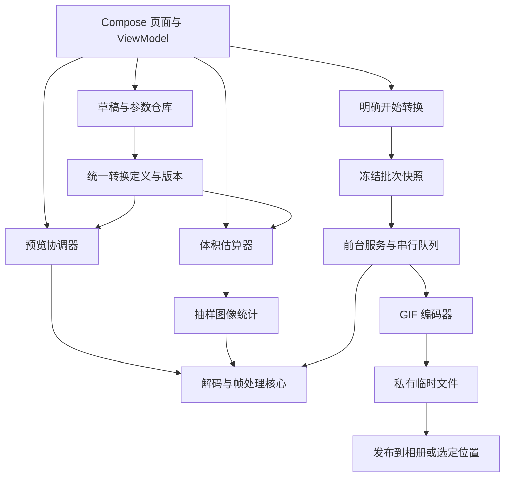

# Video2Gif 技术架构

## 状态与现有工程

本文是 2026-11-05 的建议实施基线，不表示功能已经实现或经过真机验证。产品与交互约束见 [PRODUCT.md](PRODUCT.md)，视觉见 [DESIGN.md](DESIGN.md)，实施与验收见 [IMPLEMENTATION.md](IMPLEMENTATION.md)。

当前工程：单一 `app` 模块、Kotlin、Compose、Material 3；`minSdk = 24`、`compileSdk = 37`、`targetSdk = 37`。只读检查发现页面与配色仍是模板。本轮不修改版本、不检查 SDK 安装、不运行 Gradle；实施时再核实依赖、SDK 37 行为和发布要求。

## 技术选择

| 层次 | 建议 | 理由与边界 |
|---|---|---|
| UI | Jetpack Compose + Material 3 | 复用现有工程，统一安卓交互、主题、无障碍 |
| 页面状态 | ViewModel + StateFlow + 单向数据流 | UI 状态与后台任务状态分离；协程负责取消过期预览 |
| 文件导入 | Android Photo Picker；不可用时 SAF | 视频统一入口；不为了导入申请整个媒体库权限 |
| 元信息 | MediaExtractor / MediaMetadataRetriever | 读取轨道、时长、方向等；不能靠扩展名判定支持 |
| 视频解码 | MediaExtractor + MediaCodec | 使用设备解码器，顺序解码到目标时间戳；限制软解回退规模 |
| 画面处理 | 共用颜色、旋转、裁剪、缩放规范，GPU 可加速 | HDR→SDR、色彩空间、坐标和采样时刻必须一致 |
| GIF 核心 | 独立原生接口；建议评估 giflib + 自有量化/抖动层 | giflib 负责底层 GIF 写入与 LZW；量化、帧优化和时间策略由应用控制 |
| 持久化 | Room + DataStore | Room 保存草稿、批次、单项状态；DataStore 保存主题与默认偏好 |
| 转换调度 | 用户启动的前台服务 + 串行任务引擎 | 提供通知进度、取消；避免同时编码 10 个视频 |
| 文件输出 | 私有临时文件 → MediaStore / SAF 发布 | 完整编码成功后再公布，失败不留下损坏成品 |

不引入完整 FFmpeg 发行包作为首版基础依赖：目标是手机常见录像，优先使用系统解码以控制体积、功耗和维护范围。后续若实际样本暴露明确格式缺口，再单独决定是否引入软件解码。原生库维护状态、许可证、ABI、16 KB 内存页支持与依赖来源必须在选型阶段确认，不能凭架构建议直接认定可发布。

## 逻辑模块

先在现有 `app` 内按包分层；原生媒体实现单独建 library 模块。待依赖边界稳定后再拆更多 Gradle 模块，避免为小应用引入无必要的构建复杂度。

编码器只由任务引擎持有，预览和估算接口不暴露编码方法。共用“像素处理”不等于共用“编码任务”。

建议逻辑边界：

- `feature/import`：选择器、导入校验、缩略图。
- `feature/editor`：时间轴、裁剪、参数、当前预览。
- `feature/batch`：任务汇总、开始转换、进度与结果。
- `feature/settings`：主题、默认参数、保存位置。
- `domain`：转换定义、参数约束、批次规则与状态机。
- `data`：Room、DataStore、URI 与成品记录。
- `media/source`：设备能力、解封装、解码与源文件访问。
- `media/frame`：颜色处理、缩放、调色板、量化与抖动。
- `media/preview`：受限缓存、播放时钟、预览降级。
- `media/estimate`：采样、特征、模型与区间。
- `media/export`：原生 GIF 编码、进度、取消与结果发布。

## 核心数据

| 数据 | 内容 |
|---|---|
| SourceAsset | URI、可持久访问状态、大小、时长、编码、实际尺寸、旋转、色彩/HDR 信息、源指纹 |
| ConversionRecipe | 截取区间、规范化裁剪坐标、用户旋转、目标尺寸、帧率、速度、颜色数、抖动、循环次数、算法版本 |
| BatchDraft | 共用默认值、条目顺序、各项覆盖字段；最多 10 项 |
| PreviewAnalysis | 源指纹、参数版本、抽样调色板、图像统计、采样覆盖率、估算置信等级 |
| ExportJob | 批次快照、有效参数、调色板/生成版本、任务状态、进度、临时路径、输出 URI、错误分类 |
| SizeEstimate | 中心估计、上下界、模型版本、样本覆盖率、计算状态；内部统一字节 |

有效参数由“批次默认值 + 单项覆盖”计算。截取与取景框不作为跨视频默认值复用。任何影响视觉的参数变更都增加版本，过期协程结果不能写回当前 UI。

## 统一画面处理链

解封装 → 按显示时间戳解码 → 正确处理源方向与色彩 → HDR 必要时映射为 SDR → 用户旋转 → 画面裁剪 → 缩放 → 基于共同调色板进行颜色映射（结合有序抖动）→ 得到索引色帧。

预览在此结束并把处理后的帧显示到屏幕；正式导出继续执行重复帧合并、差分矩形优化、LZW 压缩、GIF 容器写入。

调色板建议采用基于截取片段分层抽样生成的单个全局调色板，首版优先考虑 Wu 量化等可维护的确定性实现。相同抽样与种子在两条链中一致，避免每帧独立调色板导致闪烁。抖动固定在输出像素坐标系中，作为像素映射到调色板时的决策步骤，而不是对已经完成的 GIF 做后处理；具体函数的输入/输出约定在媒体核心内统一，不能让预览与编码各自解释。

色彩与缩放可能采用 GPU 加速，但量化算法、颜色空间和舍入规则必须有统一参考实现；不同设备路径采用图像误差验收。HDR 支持按“能读取、能正确映射、能预览并输出”逐项检测，不把解码成功当成颜色正确。

## 输入兼容性

- 主测试组合：MP4 中的 AVC/H.264、HEVC/H.265；不同分辨率、方向和可变帧率。
- 10-bit HEVC、HDR10、HLG 作为设备能力相关路径；验证 tone mapping 后开放。
- WebM/VP9、AV1 等作为平台支持即可导入的扩展组合，不承诺所有安卓版本、容器和设备都支持。
- 无视音轨进行 GIF 输出；有多条视频轨时选择实际主视频轨，检查有效时长和可解码样本。
- 实际内容探测优先于 MIME 和扩展名；损坏、受保护、无视频轨、暂不可读取分别返回友好错误。
- Photo Picker 可能返回云端媒体；等待用户选取的内容可读取后再分析，不暗中扫描媒体库。应用自身转换保持本地。
- 不启用 Photo Picker 的 HDR 自动转码：适用 API 上将 `MediaCapabilities` 保持为 `null`。该功能会在返回 URI 前生成转码视频，与本产品的“确认前只解码和模拟”原则不符。对于系统其他兼容转码路径，也要声明真实支持能力并检查提供方行为，不依赖透明转码来声称原生解码兼容。[A2]
- Photo Picker 不可用时走系统文件选择；对 URI 的持久化授权按提供方能力申请与记录。不能持久化且需后台处理时复制到私有缓存，并说明正在准备文件、检查空间。

以上格式与 HDR 能力边界以 Android 支持格式表和色调映射接口为依据 [A1][A7]。例如 `KEY_COLOR_TRANSFER_REQUEST` 自 API 31 提供，但配置后仍需检查请求是否被解码器接受；不能只根据系统版本开启功能。首版若使用 Media3 的处理能力，复用其像素处理路径需另行确认接口稳定性，不在预览中调用 Transformer 导出 MP4。[A7][A8]

## 无编码效果预览

### 时序

设源截取起点为 `t0`，源截取时长为 `D`，速度倍率为 `s`，目标帧率为 `f`。输出时长 `T = D / s`，目标采样数约 `N = ceil(T × f)`。输出第 k 帧对应源时刻 `t0 + s × k / f`，末帧不越过截取终点。

以视频实际 PTS 选择可用源帧，正确处理 VFR；不依赖标称帧率或文件总帧数。GIF 延迟单位为 10 ms [A9]，正式输出采用误差累积补偿，末帧按实际剩余时长修正；极短末帧需要与前帧合并，避免零延迟和各播放器最小延迟策略导致异常。预览使用同一延迟表。超过源有效帧率时允许帧重复，界面提示“源视频帧率较低，提高设置不会增加细节”。

### 工作方式

1. 导入后立即显示源缩略图与基本信息，不等待完整抽样。
2. 暂停状态下修改参数，先更新当前帧的处理效果；约 150–250 ms 防抖后刷新片段统计和调色板。
3. 分散抽取少量帧生成调色板并计算估算特征，完成后显示“效果预览就绪”。
4. 播放时按输出时间表顺序解码和处理，仅维护有限的前后帧缓存，不预生成整段帧序列。
5. 时间轴跳转先定位前一个关键帧，再顺序解码到目标时刻；不能把每一帧都交给昂贵的随机 seek。
6. 当前视频离开工作区即释放其活跃解码器。其他条目只保存缩略图与分析结果，不同时播放。

普通播放要展示实际减色、抖动和目标帧率，而非仅播放原视频。提供短按切换“原视频 / 效果预览”对照，保持相同时间位置。原视频对照不是默认效果预览。

### 性能与真实性

默认在实际输出分辨率上执行效果处理，屏幕只缩放展示。若高分辨率或较弱设备无法实时处理，优先降低预览分辨率并明确显示“预览已降低分辨率，导出仍为 1080 px”；提供暂停帧的实际尺寸检查。降低预览分辨率时调色板仍基于统一分析结果，但像素级抖动只能近似。

预览性能不足导致掉帧时，应提示或降低预览负载，不能把设备卡顿伪装成用户所选低帧率。常驻缓存按字节预算控制，初始建议每项活动预览约 16–32 MiB、最多一个解码器，实际预算需结合低内存机测试。缓存键包含源指纹、处理参数、调色板版本、源时间戳和预览尺寸。

## 不编码的体积估算

### 估算方法

不能用原视频大小乘固定系数，也不能只用宽 × 高 × 帧数；原视频的帧间压缩与 GIF 的压缩机制不同。

采用两阶段估算：

1. 快速阶段：基于输出像素数、时长、帧数、颜色数和预设得到宽区间，显示“初步估算”。
2. 分析阶段：在截取区间分散采样若干短时间窗，每个窗内按目标帧率采连续帧，覆盖开始、中间、结尾及明显场景变化；提取量化后的颜色分布、空间熵、重复图案、连续相同像素比例、变化矩形面积、重复帧比例、抖动强度。必要时增加样本，但设置解码时长与像素预算。

相邻样本必须来自真实的目标帧间隔，不能拿相隔数秒的两张图估算每帧运动量。低分辨率统计采用校准系数，并抽少量目标分辨率小区域估计细节；不要求把整段视频完整解码。

概念模型：预计字节 = 容器及调色板开销 + 各片段预计有效帧数 × 预计变化区域像素 × 预计压缩字节/像素。压缩项来自离线训练或拟合的统计模型，不运行 LZW，不维护试编码字典，不输出临时 GIF。重复帧合并与差分策略必须和正式编码器配置一致。

置信区间依据样本覆盖、场景波动和离线验证残差产生；纹理复杂、噪声较多、强抖动、突发场景切换时区间变宽。范围按易读单位取整，不能显示无依据的小数精度。

### 参数更新与复用

- 改循环次数基本只改变元信息，不重新扫描画面。
- 改尺寸、调色板或抖动，复用已解码的小型源样本，重新计算图像统计。
- 改帧率或速度，重新对齐相邻采样间隔，不直接线性缩放全部结果。
- 改截取范围或裁剪，作废受影响样本，取消旧任务，更新覆盖率。
- 批量估算优先当前项，其余顺序低优先级处理；开始正式转换后暂停非必要预览分析。

### 准确率目标与边界

以下为待验证目标，不是现有精度声明：代表性独立测试集上，实际成品 ≥1 MiB 时，中位绝对相对误差目标 ≤20%，P90 目标 ≤35%；小文件以绝对误差目标 ≤256 KiB 评估，另报告分布。显示区间覆盖率目标 ≥90%，同时报告区间宽度，避免用极宽区间制造“准确”。

验证集按原始视频划分，不能让同一视频的不同裁剪同时落入训练集和测试集。分别报告夜景噪声、运动、静态、屏幕录制、HDR 各组误差。极端场景无法保证误差上限；若总体达不到目标，应调整模型与展示范围，不能偷偷启动试编码。

离线校准阶段可以由开发测试流程真正生成 GIF 作对照；这不属于用户预览阶段。应用完成用户明确发起的转换后，可在本地保存匿名特征与实际大小用于后续评估，不存画面、不自动上传。自动在线改模型首版暂缓，以保持行为稳定。

## 正式转换与任务生命周期

用户点击“开始转换（N）”后，重新校验 URI 可读性、参数、可用空间和任务重复提交，冻结参数、分析版本与调色板，然后创建持久任务。估算不是硬性完成条件；未完成时显示“体积尚未估算完成”，不能显示假数值。

单项状态：`Queued → Preparing → Decoding/Encoding → Finalizing → Publishing → Succeeded`。任一活动阶段可进入 `Failed` 或 `Canceled`；进程意外消失后将未完成项识别为 `Interrupted`，由用户重试或在满足平台规则时恢复排队，不能错误标成成功。

- 默认一次只编码一个视频。有界缓冲与背压串接解码、处理、编码，不能缓存全部 RGBA 帧。
- 首版编码器以不透明全帧、正确延迟、全局调色板为正确性基线，再加入重复帧合并和不透明差分矩形优化；优化后要验证帧处置规则，防止拖影。
- 单项进度基于已处理输出时间或采样帧数；发布阶段保留独立状态。总进度按估算工作量加权，不能简单平均 10 个视频的百分比。
- 剩余时间必须等待实际吞吐稳定后再估算；不承诺后台一直不被系统终止。
- 取消令牌传至 native 层与 IO；取消后释放解码器并移除该项未发布临时文件，已成功结果保留。
- 首版不实现 GIF 任意帧断点续写。进程终止后，当前视频从头重试，完成项不重转。
- 应用重建读取 Room 恢复界面。启动时进行任务对账，清理孤立临时文件，核对已发布 URI，避免崩溃窗口产生重复成品。

### Android 后台限制

用户在可见页面发起长任务并启动前台服务，持续提供通知与取消操作。Android 15+ 使用 `mediaProcessing`；Android 10–14 的本地文件处理使用 `dataSync` 路径，Android 7–9 使用对应版本的普通前台服务机制；权限、服务类型和启动 API 都按版本分支，不能在旧版直接假设 `mediaProcessing` 存在。[A4]

当前官方文档规定媒体处理前台服务有运行时间预算；Android 15+ 的相关后台运行预算通常为每 24 小时累计 6 小时，同类型服务共享预算，不能通过新建服务延长。[A4][A5] 实施前仍需根据实际 target SDK 核对启动限制、超时回调、通知权限和重启行为。服务到达平台时限时停止当前项并保存可恢复的队列状态。通知被拒绝不等于任务成功或失败，应用内仍需完整显示状态。

WorkManager 可用于符合条件的清理或恢复提示，不作为规避前台服务限制的无限执行手段；首版避免让 WorkManager 和服务同时拥有同一批次。

## 输出与权限

- 默认文件名含源名称与唯一后缀，输出 MIME 为 `image/gif`；不覆盖已有文件。
- Android 10+ 使用 MediaStore pending 状态发布完整文件；失败或取消清除 pending 项。
- Android 7–9 优先通过 SAF 保存到用户选择位置，或先保存私有结果供分享；不为了统一外观索取宽泛存储权限。
- 私有临时结果写完并关闭后，复制到目标、验证完整写入，再标记成功。为临时文件和目标副本预留空间，运行中监测不足。
- 对无法提供原子发布能力的 SAF 提供方采用临时命名/失败清理的尽力策略；若清理失败需报告并记录 URI，不能宣称所有提供方都保证原子性。
- 分享走系统 Sharesheet，授予临时读取权限；私有文件使用 FileProvider。来源或成品被用户删除时显示“文件已不可用”。

## 安全与隐私基线

视频路径、文件名和帧内容不写入普通运行日志。临时帧只放有界内存或私有缓存；草稿与 URI 授权不能作为跨设备恢复依据。备份规则需排除媒体缓存、未完成任务与无效授权引用。导入内容先做尺寸、时长和解码资源检查，原生媒体处理必须保持可取消和资源上限。

## 官方资料与实施核对入口

本轮联网核对了媒体格式、Photo Picker 转码、前台服务、HDR 处理、GIF 计时与原生库页大小等关键约束；没有安装依赖或执行设备实验。以下资料是设计依据；实施时仍需按所用 SDK 和依赖版本重新核对。资料核对日期：2026-11-05。

- [A1 Android 支持的媒体格式](https://developer.android.com/media/platform/supported-formats)
- [A2 Photo Picker：选择限制、持久访问和可选 HDR 转码](https://developer.android.com/training/data-storage/shared/photo-picker)
- [A3 共享媒体存储](https://developer.android.com/training/data-storage/shared/media)（实施核对入口）
- [A4 前台服务类型：mediaProcessing 与 dataSync](https://developer.android.com/develop/background-work/services/fgs/service-types)
- [A5 前台服务超时](https://developer.android.com/develop/background-work/services/fgs/timeout)
- [A6 16 KB 内存页支持](https://developer.android.com/guide/practices/page-sizes)
- [A7 MediaFormat：KEY_COLOR_TRANSFER_REQUEST](https://developer.android.com/reference/android/media/MediaFormat#KEY_COLOR_TRANSFER_REQUEST)
- [A8 Media3 HDR/SDR 色调映射能力边界](https://developer.android.com/media/media3/transformer/tone-mapping)
- [A9 GIF89a 格式规范](https://giflib.sourceforge.net/gifstandard/GIF89a.html)
- [A10 GIFLIB 项目与发行入口](https://giflib.sourceforge.net/)（候选库，尚未锁定版本）
