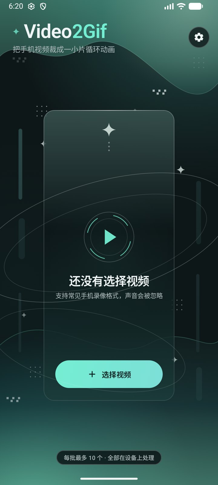
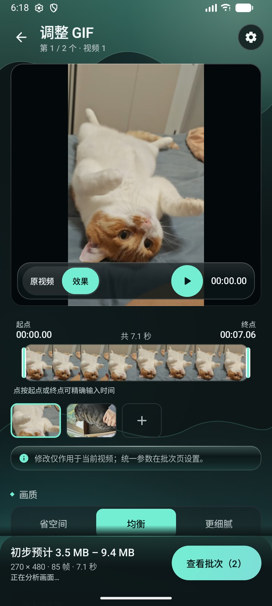
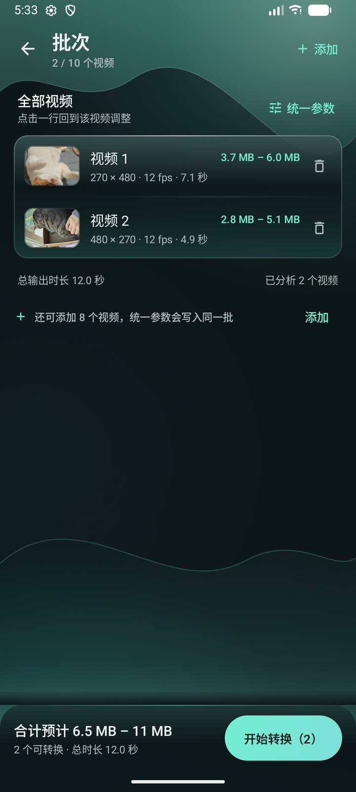
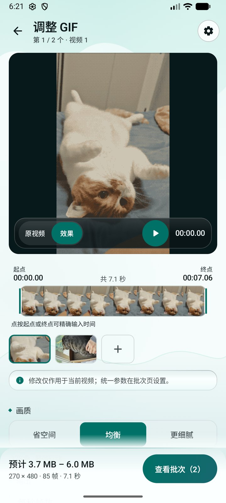
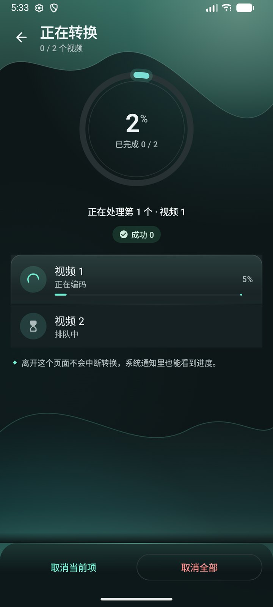
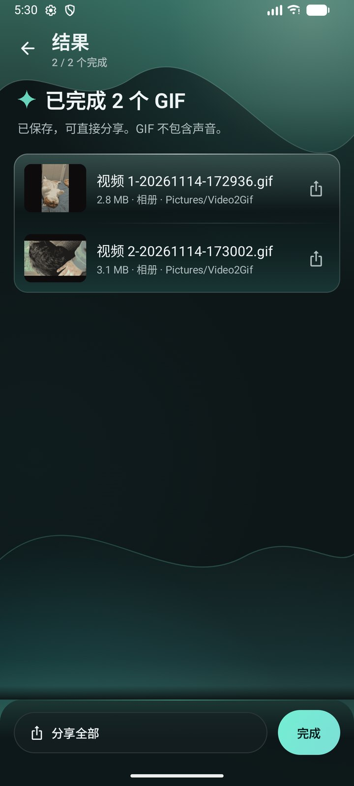
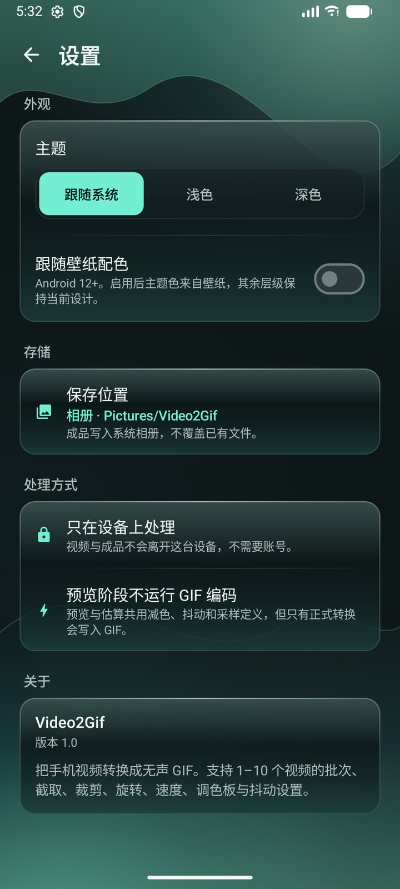
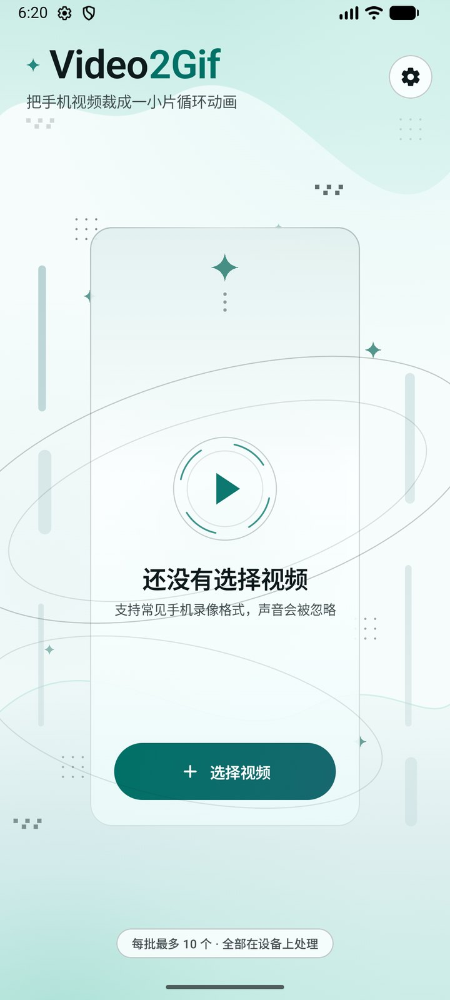

# Video2Gif

把手机视频转成无声 GIF 的安卓应用。先预览效果、估算体积，确认后才开始编码；所有处理在设备上完成，不需要账号或上传。

界面为 Jetpack Compose + Material 3，视觉语言是「极光石墨 + 玻璃主卡片」：近黑青灰底、薄荷极光、竖向玻璃主卡片与几何装饰线。设计依据见 [DESIGN.md](DESIGN.md)，产品与技术约束见 [PRODUCT.md](PRODUCT.md) 与 [ARCHITECTURE.md](ARCHITECTURE.md)。当前实现状态、偏差与验收证据见 [DEVELOPMENT.md](DEVELOPMENT.md)。

  

## 已实现

- **导入**：系统 Photo Picker，单批 1–10 个视频；读取真实时长、显示尺寸、方向与缩略图；Photo Picker 不可用时由系统文件选择器回退。
- **无编码效果预览**：同一份 `ConversionRecipe`、同一 Wu 调色板与有序抖动驱动预览和导出；支持原视频/效果对照、按目标帧率播放、暂停、拖动定位；预览阶段不创建 GIF、不调用编码器。
- **参数**：画质（省空间/均衡/更细腻）、颜色数、抖动、帧率、长边尺寸、截取区间、裁剪取景框、旋转、速度、循环次数。常用项直接可见，专业项在高级设置中。
- **体积估算**：两阶段估算；分析阶段在实际输出分辨率上抽取连续帧，统计索引色熵、相邻像素相等比例等特征，按同一调色板/抖动推断 LZW 码率，只输出区间，不试编码。批量合计只在全部就绪后显示。
- **正式转换**：纯 Kotlin GIF89a 编码器（LZW、全局调色板、NETSCAPE 循环扩展、逐帧延迟误差补偿），输出到 `Pictures/Video2Gif`（Android 10+ 通过 MediaStore pending 发布；旧版保存到应用图片目录并支持分享）。
- **批次**：逐项覆盖、统一参数、单独设置标记、错误项阻止整批开始、串行前台服务、通知进度、取消当前/全部、失败项保留原因并重试。
- **设置与任务恢复**：DataStore 保存设置，SharedPreferences 保存转换任务快照；进程中断后未完成项标记为“已中断”，已完成文件保留。首页始终选择新视频，不保存或恢复上次编辑。
- **主题与适配**：跟随系统/浅色/深色；Android 12+ 可选的壁纸配色；平板或宽窗口切为左侧预览、右侧参数；手机横屏仍可滚动使用；触控目标、数值输入与主要 TalkBack 描述已加入。

## 截图

| 调整（深色） | 调整（浅色） | 转换进度 |
|---|---|---|---|
|  |  |  |

| 结果 | 设置（深色） | 首页（浅色） |
|---|---|---|
|  |  |  |

## 构建

环境：JDK 25、Android SDK 37、Gradle Wrapper 9.6.0、AGP 9.5.0、Kotlin 2.2.10（本次构建使用 Android Studio 自带 JBR 25，可用 `JAVA_HOME=/opt/android-studio/jbr ./gradlew ...`）。`minSdk = 24`、`compileSdk/targetSdk = 37`。

```bash
./gradlew :app:assembleDebug
./gradlew :app:testDebugUnitTest
adb install -r app/build/outputs/apk/debug/app-debug.apk
```

单元测试覆盖 LZW 位流往返、Wu 量化器可用性、GIF 头与循环扩展。

## 代码结构

```text
app/src/main/java/com/example/video2gif/
├── domain/       参数、批次、输出规格、GIF 计时、任务状态
├── media/        解码、Wu 量化、抖动、LZW/GIF 编码、体积估算、发布
├── data/         DataStore 设置、任务快照 JSON
├── service/      串行转换引擎、前台服务、通知
├── ui/           Compose 页面、组件、ViewModel、主题
└── Video2GifApp.kt
```

`media/` 中预览、估算与导出共用 `PaletteBuilder`、`ColorPalette`、`mapToIndices` 与采样时间表；编码器只由转换引擎持有。没有原生 `.so` 依赖，便于审查和构建。

## 边界

- 首版未实现 HDR 自动色调映射与显式能力探测；HDR 来源在发布前仍需专项验证。
- 预览解码使用 `MediaMetadataRetriever`，并非完整 MediaCodec 管线；高分辨率长片段预览性能有限，必要时显示“预览已降分辨率”。
- 体积估算在合成测试素材上校准，尚未用真实手机录像分布完成目标误差验收。
- 环境与验证记录、已知问题见 [DEVELOPMENT.md](DEVELOPMENT.md)。
